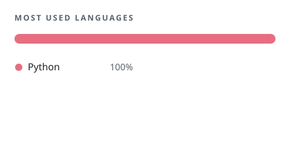

<!-- If you are reading the source: hello. -->
<picture>
  <source media="(prefers-reduced-motion: reduce) and (prefers-color-scheme: dark)" srcset="https://raw.githubusercontent.com/FreemanKlay/FreemanKlay/cards/banner-dark-static.svg">
  <source media="(prefers-reduced-motion: reduce)" srcset="https://raw.githubusercontent.com/FreemanKlay/FreemanKlay/cards/banner-light-static.svg">
  <source media="(prefers-color-scheme: dark)" srcset="https://raw.githubusercontent.com/FreemanKlay/FreemanKlay/cards/banner-dark.svg">
  
</picture>

**Core Engine & Tools** 
Engine architecture · Tools development · Systems programming · Graphics programming

**Game Development** 
Gameplay programming · Game architecture · Interactive media

**Software Engineering** 
Performance optimization · Software architecture · Creative technology

**Stack** 
<picture>
  <source media="(prefers-color-scheme: dark)" srcset="https://raw.githubusercontent.com/FreemanKlay/FreemanKlay/cards/stack-dark.svg">
  
</picture>

**Tools** &nbsp; `Unreal Engine`

**Speaks** &nbsp; English · Español · Português

<!--
CONTACT: decida os canais e descomente.
**Contact** &nbsp; [Email](mailto:voce@exemplo.com) · [LinkedIn](https://linkedin.com/in/...) · [Site](https://...)
-->

<picture>
  <source media="(prefers-color-scheme: dark)" srcset="https://raw.githubusercontent.com/FreemanKlay/FreemanKlay/cards/summary-dark.svg">
  
</picture>
<picture>
  <source media="(prefers-color-scheme: dark)" srcset="https://raw.githubusercontent.com/FreemanKlay/FreemanKlay/cards/languages-dark.svg">
  
</picture>
<picture>
  <source media="(prefers-color-scheme: dark)" srcset="https://raw.githubusercontent.com/FreemanKlay/FreemanKlay/cards/weekly-dark.svg">
  
</picture>

