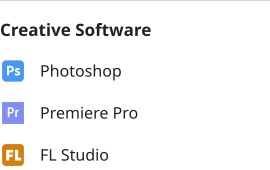
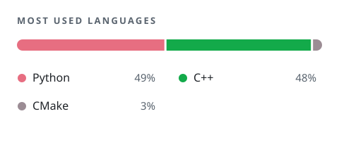

<!-- If you are reading the source: hello. -->
<picture>
  <source media="(prefers-color-scheme: dark)" srcset="https://raw.githubusercontent.com/FreemanKlay/FreemanKlay/cards/banner-dark.svg">
  
</picture>

**Core Engine & Tools** 
Engine architecture · Tools development · Systems programming · Graphics programming

**Game Development** 
Gameplay programming · Game architecture · Interactive media

**Software Engineering** 
Performance optimization · Software architecture · Creative technology

 

<picture>
  <source media="(prefers-color-scheme: dark)" srcset="https://raw.githubusercontent.com/FreemanKlay/FreemanKlay/cards/label-stack-dark.svg">
  
</picture>

<picture>
  <source media="(prefers-color-scheme: dark)" srcset="https://raw.githubusercontent.com/FreemanKlay/FreemanKlay/cards/chip-cpp-dark.svg">
  
</picture>
<picture>
  <source media="(prefers-color-scheme: dark)" srcset="https://raw.githubusercontent.com/FreemanKlay/FreemanKlay/cards/chip-typescript-dark.svg">
  
</picture>
<picture>
  <source media="(prefers-color-scheme: dark)" srcset="https://raw.githubusercontent.com/FreemanKlay/FreemanKlay/cards/chip-javascript-dark.svg">
  
</picture>
<picture>
  <source media="(prefers-color-scheme: dark)" srcset="https://raw.githubusercontent.com/FreemanKlay/FreemanKlay/cards/chip-python-dark.svg">
  
</picture>
<picture>
  <source media="(prefers-color-scheme: dark)" srcset="https://raw.githubusercontent.com/FreemanKlay/FreemanKlay/cards/chip-java-dark.svg">
  
</picture>
<picture>
  <source media="(prefers-color-scheme: dark)" srcset="https://raw.githubusercontent.com/FreemanKlay/FreemanKlay/cards/chip-sql-dark.svg">
  
</picture>

 

<picture>
  <source media="(prefers-color-scheme: dark)" srcset="https://raw.githubusercontent.com/FreemanKlay/FreemanKlay/cards/label-tools-dark.svg">
  
</picture>

<picture>
  <source media="(prefers-color-scheme: dark)" srcset="https://raw.githubusercontent.com/FreemanKlay/FreemanKlay/cards/tools-1-dark.svg">
  
</picture>
<picture>
  <source media="(prefers-color-scheme: dark)" srcset="https://raw.githubusercontent.com/FreemanKlay/FreemanKlay/cards/tools-2-dark.svg">
  
</picture>
<picture>
  <source media="(prefers-color-scheme: dark)" srcset="https://raw.githubusercontent.com/FreemanKlay/FreemanKlay/cards/tools-3-dark.svg">
  
</picture>

 

<picture>
  <source media="(prefers-color-scheme: dark)" srcset="https://raw.githubusercontent.com/FreemanKlay/FreemanKlay/cards/label-speaks-dark.svg">
  
</picture>

<picture>
  <source media="(prefers-color-scheme: dark)" srcset="https://raw.githubusercontent.com/FreemanKlay/FreemanKlay/cards/speak-english-dark.svg">
  
</picture>
<picture>
  <source media="(prefers-color-scheme: dark)" srcset="https://raw.githubusercontent.com/FreemanKlay/FreemanKlay/cards/speak-espanol-dark.svg">
  
</picture>
<picture>
  <source media="(prefers-color-scheme: dark)" srcset="https://raw.githubusercontent.com/FreemanKlay/FreemanKlay/cards/speak-portugues-dark.svg">
  
</picture>

<!--
-->

 

<picture>
  <source media="(prefers-color-scheme: dark)" srcset="https://raw.githubusercontent.com/FreemanKlay/FreemanKlay/cards/summary-dark.svg">
  
</picture>
<picture>
  <source media="(prefers-color-scheme: dark)" srcset="https://raw.githubusercontent.com/FreemanKlay/FreemanKlay/cards/languages-dark.svg">
  
</picture>
<picture>
  <source media="(prefers-color-scheme: dark)" srcset="https://raw.githubusercontent.com/FreemanKlay/FreemanKlay/cards/weekly-dark.svg">
  
</picture>
<picture>
  <source media="(prefers-color-scheme: dark)" srcset="https://raw.githubusercontent.com/FreemanKlay/FreemanKlay/cards/corner-dark.svg">
  
</picture>

