**Stack** &nbsp; `C++` `Python` `JavaScript` `Unreal Engine` `Git`

**Languages** &nbsp; English · Español · Português

 

<picture>
  <source media="(prefers-color-scheme: dark)" srcset="https://raw.githubusercontent.com/FreemanKlay/FreemanKlay/cards/summary-dark.svg">
  
</picture>
<picture>
  <source media="(prefers-color-scheme: dark)" srcset="https://raw.githubusercontent.com/FreemanKlay/FreemanKlay/cards/languages-dark.svg">
  
</picture>
<picture>
  <source media="(prefers-color-scheme: dark)" srcset="https://raw.githubusercontent.com/FreemanKlay/FreemanKlay/cards/weekly-dark.svg">
  
</picture>

